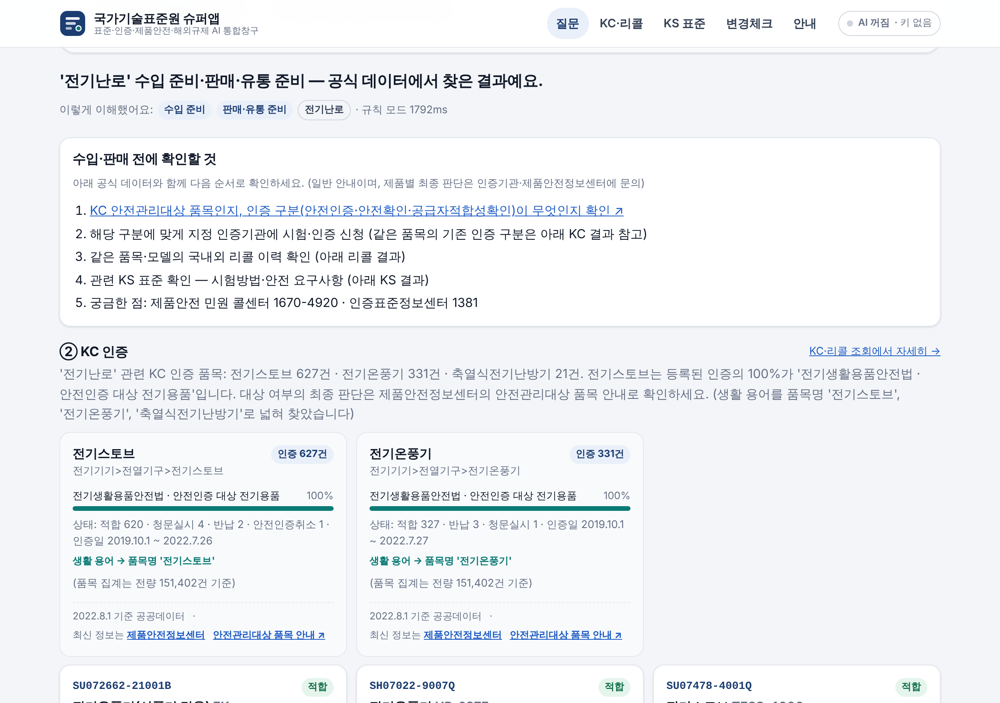
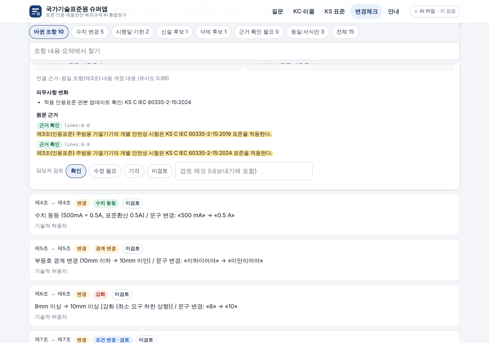
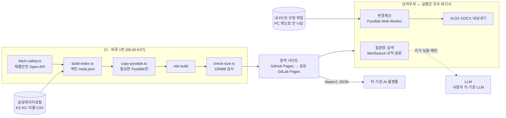

# 「국가기술표준원 슈퍼앱」 — 표준·인증·제품안전·해외규제 AI 통합창구

> **2026년 산업부 AI 활용 경진대회(개발 분야) 시제품**입니다. 국가기술표준원 공식 서비스가 아니며, 결과는 법적 판단 근거가 아닙니다.

"이 제품 수입하려면 뭐가 필요해?"를 물으면 **KC 인증·리콜·KS 표준·해외규제**를 한 번에 찾아 **공식 출처·기준일과 함께** 답하는 웹 창구입니다.
서버 없이 **CI가 미리 만들고 브라우저가 실행**하는 정적 사이트로, GitHub Pages에서 시연하고 같은 빌드 결과물을 공공 GitLab Pages로 옮길 수 있습니다.

- **시연 주소**: https://yukari9966x.github.io/project20261105/
- **핵심 원칙 — 사실은 원본, 설명은 AI**: 인증 상태·리콜 여부·표준번호는 공공데이터 원본값을 그대로 보여 주고, AI는 질문 해석과 요약만 맡습니다. 모든 결과 카드에 자료 기준일과 원문 링크를 붙입니다.
- **키 없이 동작**: 심사·일반 이용은 '키 없음' 모드로 충분합니다. AI는 사용자가 자기 키나 기관 LLM 주소를 넣을 때만 켜집니다.

| ① AI 통합 질문창 | ④ 해외규제 변경체크 | 휴대폰 |
|---|---|---|
|  |  |  |

## 미니앱

| 미니앱 | 하는 일 | 연결 데이터 | 상태 |
|---|---|---|---|
| ① AI 통합 질문창 | 질문을 해석해 필요한 미니앱을 부르고, 답마다 공식 출처를 붙임 | ②~④ | 제공 |
| ② KC 인증·리콜 조회 | 제품명·모델명·인증번호로 인증 상태와 국내외 리콜 | 제품안전 공공데이터 + Open API(CI가 하루 1번 수집) | 제공 |
| ③ KS 표준 찾기 | 표준번호·표준명 검색, 최종고시상태, 국제표준 인용 여부 | 이나라표준인증 국가표준 33,266건 | 제공 |
| ④ 해외규제 변경체크 | 구판·신판 규정을 조항 단위로 대조, 수치·기한·원문 근거, XLSX·DOCX | 기존 `kats-regulation-diff` 엔진(브라우저 이식) | 제공 |
| ⑤ 수출 준비 · ⑥ 직원 업무 · ⑦ 관심 품목 알림 | TBT 통보문, 고시·매뉴얼 질의, 리콜·KS 개정 알림 | WTO ePing, 내부 문서 등 | 2단계 |

## 구조



| 계층 | 선택 | 이유 |
|---|---|---|
| 화면 | Vite + React + TypeScript, 해시 라우팅(`#/kc`, `#/diff`) | 정적 파일만 나옴. 어느 Pages 경로에서도 새로고침 404 없음 |
| 검색 | MiniSearch + 빌드 때 만든 색인 JSON, 한글 2글자 토큰 | 서버 없이 KS 33,266건·리콜을 바로 검색 |
| 변경체크 | Pyodide 314.0.7(Python 3.14) + Web Worker | 기존 Python 엔진 재사용, 분석 중에도 화면이 멈추지 않음 |
| 엔진 의존성 | lxml·pydantic은 Pyodide 내장, pypdf·python-docx·openpyxl·et-xmlfile·defusedxml은 micropip | 순수 Python 휠만 micropip로 설치 (Pillow는 엔진이 쓰지 않아 뺌) |
| Pyodide 파일 | 사이트에 함께 넣음(자체 호스팅, 17.7MB) | 외부 CDN 없이 내부망에서도 동작 |
| 질문창 | 규칙 기반 의도 분류 + (선택) 브라우저에서 OpenAI 호환 API 직접 호출 | 키가 없어도 검색은 동작 |
| 공개 데이터 | `/data/v1/*.json` (스키마 `kats-superapp/data/v1`) | 다른 기관·AI 플랫폼이 그대로 가져다 씀 |

## 데이터 출처

| 데이터 | 공공데이터포털 | 기준 | 건수 | 이용허락 |
|---|---|---|---|---|
| 이나라표준인증 국가표준(KS 목록) | [15131276](https://www.data.go.kr/data/15131276/fileData.do) | 2024-09-13 | 33,266 | 제한 없음 |
| 제품안전 인증제품 정보(KC) | [15040703](https://www.data.go.kr/data/15040703/fileData.do) | 2022-08-01 (인증일 2019-10~2022-07) | 152,433 | 제한 없음 |
| 제품안전 국내리콜정보 | [15040696](https://www.data.go.kr/data/15040696/fileData.do) | 2023-08-09 (등록일 2019-10~2022-07) | 881 | 제한 없음 |
| 제품안전 국외리콜정보 | [15040707](https://www.data.go.kr/data/15040707/fileData.do) | 2021-08-23 | 2,566 | 제한 없음 |
| 제품 안전인증 및 리콜 정보 Open API | [15116894](https://www.data.go.kr/data/15116894/openapi.do) → [제품안전정보센터](https://www.safetykorea.kr/release/openapi) | CI 수집 시각 | — | 서비스키 필요 |

원본 파일은 [`data/raw/`](data/raw)에 두고 출처·해시를 [`data/raw/SOURCES.json`](data/raw/SOURCES.json)에 적었습니다(갱신주기 '수시' — 바뀔 때만 교체).
KC 인증은 전량(15만 건)이 커서 **개별 기록은 최근 3만 건**, **제품명별 집계는 전량**을 넣고, 나머지·현재 상태는 제품안전정보센터 링크로 보냅니다(파일데이터의 '적합'이 지금은 '개선명령'인 사례가 있어 모든 카드에 현재 상태 링크를 붙임).

### 제품안전 Open API 수집 켜기

Open API는 제품안전정보센터가 발급하는 **서비스 ID**를 HTTP 헤더 `AuthKey`로 보냅니다([인터페이스 설계서 v2.1](https://www.safetykorea.kr/resources/fileData/openapi/Open_API_%EC%82%AC%EC%9A%A9%EC%84%A4%EB%AA%85%EC%84%9C_v2.1.pdf)).

1. [신청서](https://www.safetykorea.kr/release/openapi)를 작성해 safetykorea@korea.kr 로 보내 서비스 ID를 받습니다.
2. 저장소 **Settings → Secrets and variables → Actions**에 `SAFETYKOREA_AUTH_KEY`로 넣습니다. (사이트에는 절대 들어가지 않습니다.)
3. **Actions → 수집·빌드·배포 → Run workflow**(첫 수집 날수 `backfill_days`, 기본 365). 이후 매일 06:00에 자동 수집합니다.

키가 없거나 호출이 실패하면(인증키 오류 4000, IP 제한 4001 등) **직전 스냅샷(배포된 `/data/v1`)을 그대로** 쓰고, 화면에 그 기준 시각을 표시합니다. 모든 목록은 최대 1,000줄이라 날짜(공표일·등록일)로 하루씩 나눠 받습니다.

## 실행

```bash
npm ci
```

```bash
npm run dev
```

`npm run build`는 색인 생성(`build-index.ts`) → Pyodide·엔진 복사(`copy-pyodide.ts`) → 타입 검사 → `vite build` → 용량 검사(`check-size.ts`, 100MB 초과 시 실패)를 차례로 합니다.

```bash
npm run build
```

```bash
npm run preview
```

## 테스트

| 명령 | 내용 |
|---|---|
| `npm test` | 단위 테스트 70건 — 한글 토크나이저·조사 처리, 의도 분류, 실제 데이터로 KS·KC·리콜 검색, 키 없음 답변, CSV·정규화, 모의 제품안전 API 수집(키 없음·성공·인증 오류 시 직전 스냅샷), 모의 OpenAI 호환 서버(도구 호출·키 전송 범위·함수 호출 미지원 대체) |
| `npm run test:engine` | 변경체크 엔진 25건 (원본 엔진의 단위·회귀 테스트 이식 + 파이프라인·연결부) — `pip install -r engine/requirements.txt` 필요 |
| `node scripts/smoke-pyodide.mjs --unittest` | **실제 Pyodide**에서 엔진 설치·샘플 4쌍(TXT·HWPX·PDF·DOCX) 대조·XLSX/DOCX 생성 + 엔진 테스트 25건 |
| `npm run test:e2e` | Playwright 브라우저 종단 점검 13단계 (질문창·KC·KS·변경체크·내려받기·휴대폰 폭·콘솔 오류·외부 요청 없음) |
| `python engine/scripts/evaluate.py` | 가상 규정 평가셋(정답 26사례): 규칙 엔진 단독 조항 정렬 26/26, 변경 탐지 F1 1.0, 수치·기한 13/13, 근거 유효 68/68 — 원본 v0.2와 같은 값 |

> 평가셋은 원본 엔진 개발자가 만든 가상 규정이라 과적합 가능성이 있습니다(원본 TEST_REPORT와 같은 한계).

## 배포

### GitHub Pages (지금)

1. **Settings → Pages → Build and deployment → Source: GitHub Actions** (처음 한 번)
2. 기본 브랜치에 push하거나 **Actions → 수집·빌드·배포 → Run workflow**
3. 워크플로([`.github/workflows/deploy.yml`](.github/workflows/deploy.yml))가 수집 → 빌드 → 테스트 → Pages 배포 → 배포 확인(`meta.json`)까지 합니다.

공개 저장소의 예약 실행은 60일간 활동이 없으면 자동 중지됩니다(Actions 탭에서 다시 켜기).

### 공공 GitLab Pages (이관)

바뀌는 것은 CI 파일 하나와 사이트 기본 경로뿐입니다. [`.gitlab-ci.yml`](.gitlab-ci.yml)의 `pages` 잡이 같은 명령을 실행하고 `dist/`를 `public/`으로 올립니다.

- 서비스키: **Settings → CI/CD → Variables**에 `SAFETYKOREA_AUTH_KEY` (masked·protected)
- 예약: **Build → Pipeline schedules**에 매일 06:00(Asia/Seoul)
- 경로: 기본은 상대 경로(`./`)라 Pages 도메인 규칙과 상관없이 동작합니다. 고정하려면 `BASE_PATH` 변수.
- 실행기가 인터넷에 못 나가면 Pyodide·휠을 `vendor/pyodide/`에 넣어 커밋하면 내려받지 않습니다.
- Pages 접근 제어를 켜면 다른 사이트가 데이터 JSON을 가져갈 수 없으므로 공개로 둡니다. 총용량은 48.6MB로 기본 한도(100MB) 안입니다.

## AI 연결 (선택)

**설정(#/settings)**에서 OpenAI 호환 주소·모델·키를 넣으면 켜집니다.

| 모드 | 질문창 | 변경체크 |
|---|---|---|
| 키 없음(기본) | 규칙으로 질문 종류를 가려 검색 결과 카드 | 규칙 엔진 결과(조항 정렬·수치·기한·원문 근거) |
| 사용자 키 | LLM이 검색 함수를 도구로 골라 부르고 카드를 근거로 요약(근거 번호 K1·R1·S1) | 바뀐 조항만 보내 요약·의무사항 보강(원본 엔진 프롬프트 v1, 인용문은 원문에서 재검증) |
| 기관 LLM | 같음 (내부망 LLM 주소) | 같음 — 내부 문서도 가능 |

- 설정 목록의 공급사(OpenAI, Gemini OpenAI 호환, Upstage Solar, OpenRouter, Groq, Mistral, DeepSeek, Together)는 2026-11-05에 **브라우저 직접 호출(CORS) 허용을 확인**한 곳입니다. 실제 키로 호출해 본 것은 아닙니다(심사 때 대면 시연).
- 키는 기본 sessionStorage(탭을 닫으면 삭제)에 두고 설정한 주소 외에는 보내지 않습니다. 사이트에 시연용 키는 넣지 않았습니다.
- 내부망 LLM은 서버에서 CORS 허용이 필요하고, https 사이트에서는 https 주소(또는 `http://localhost`)만 부를 수 있습니다.

## 공개 데이터 JSON

| 파일 | 내용 |
|---|---|
| [`data/v1/meta.json`](https://yukari9966x.github.io/project20261105/data/v1/meta.json) | 출처·기준 시각·건수·파일 목록(sha256) |
| `data/v1/ks.json` | KS 목록 (`no`, `label`, `name`, `status`, `intl`, `div`) |
| `data/v1/kc.json` · `kc-summary.json` | KC 인증(Open API 필드 이름) · 제품명별 집계 |
| `data/v1/recall.json` | 국내·국외 리콜, 해외직구 안전성조사 |
| `llms.txt` | AI 에이전트용 안내 |

각 레코드의 `src`가 `meta.json`의 `sources` 키(기준일·출처·이용허락)를 가리킵니다. MCP 서버는 2단계(로컬 실행 패키지)입니다.

## 제약과 대응

| 제약 | 대응 |
|---|---|
| 서버가 없어 키를 숨길 수 없음 | 핵심 기능은 키 없이 동작. AI는 사용자 키·기관 LLM |
| 실시간 조회가 아님(최대 하루 늦음) | 모든 카드에 기준 시각과 원문·현재 상태 링크 |
| 제품안전 Open API 서비스키 발급 전 | 공공데이터포털 파일데이터(2019~2022)로 동작, 키 등록 즉시 CI가 최신 자료를 더함 |
| Pyodide 첫 로딩 | 변경체크 화면에 들어갈 때만 로딩(로컬 측정 약 6초), 진행률 표시 |
| 용량 한도(GitLab 기본 100MB) | 필요한 Pyodide 패키지만, 빌드마다 총용량 검사(현재 48.6MB) |
| OCR 없음 | 스캔본 PDF는 대조 불가 — 화면에 안내 |
| 구형 HWP | HWPX·DOCX·PDF로 저장 후 사용 |

## 저장소 구조

```
├─ src/
│  ├─ main.tsx  App.tsx          # 해시 라우팅(#/, #/kc, #/ks, #/diff, #/about, #/settings)
│  ├─ pages/                     # Ask · Kc · Ks · Diff(+DiffResult) · About · Settings
│  ├─ tools/                     # 검색 함수 한 벌 → 화면·질문창·LLM 도구 공용 (ks·kc·recall·registry·synonyms·links)
│  ├─ ask/                       # 규칙 기반 의도 분류·답변 조립 (키 없음 모드)
│  ├─ search/                    # MiniSearch 색인 설정, 한글 2글자 토크나이저, 조사 처리
│  ├─ llm/                       # OpenAI 호환 브라우저 클라이언트(사용자 키), 도구 호출, 변경체크 보강
│  └─ engine/worker.ts           # Pyodide Web Worker (+ client.ts)
├─ engine/                       # kats-regulation-diff 엔진(브라우저용으로 정리) — engine/README.md
├─ data/raw/                     # 공공데이터포털 원본 (ks_standards.csv, safety/*.csv) + SOURCES.json
├─ scripts/
│  ├─ fetch-safety.ts            # 제품안전 Open API 수집(CI 전용)
│  ├─ build-index.ts             # 색인·meta.json → public/data/v1 (빌드 때 dist/data/v1)
│  ├─ copy-pyodide.ts            # 필요한 Pyodide 파일만 복사(sha256 검증) + 엔진·샘플 묶음
│  ├─ check-size.ts              # 총용량 100MB 넘으면 빌드 실패
│  └─ smoke-pyodide.mjs          # 실제 Pyodide 에서 엔진 설치·실행 점검
├─ tests/e2e/run-e2e.mjs         # 브라우저 종단 점검
├─ .github/workflows/deploy.yml  # 예약 수집 + 빌드 + Pages 배포
├─ .gitlab-ci.yml                # 이관용(같은 단계)
└─ vite.config.ts                # base: process.env.BASE_PATH
```

## 오픈소스

React(MIT) · Vite(MIT) · MiniSearch(MIT) · Pyodide(MPL-2.0) · lxml(BSD) · pydantic(MIT) · pypdf(BSD) · python-docx(MIT) · openpyxl(MIT) · et-xmlfile(MIT) · defusedxml(PSF). 변경체크 엔진의 원본 고지는 [`engine/UPSTREAM_THIRD_PARTY_NOTICES.md`](engine/UPSTREAM_THIRD_PARTY_NOTICES.md).
내장 샘플 규정 4쌍은 **가상 규정**이며 실제 법령·고시가 아닙니다.
